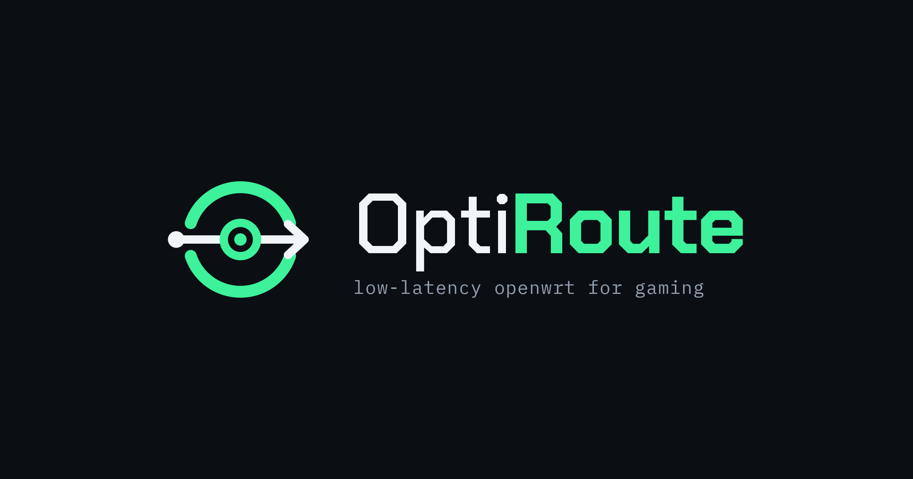

<p align="center">
  
</p>

A one-shot installer that turns a fresh OpenWrt install on an x86 mini PC into a low-latency gaming router.

On a ~400/500 Mbps fiber line, the reference build holds **3–5 ms under full load with ~1 ms of jitter** (Waveform A+, +0 ms bufferbloat). Your numbers depend on your ISP and how far you are from the servers you play on, but the router stops adding lag when the connection is busy.

## What it sets up

| Piece | What it does |
|---|---|
| [qosmate](https://github.com/hudra0/qosmate) | Bufferbloat control (HFSC or CAKE) plus a top-priority lane for your gaming devices' UDP traffic |
| [geomate](https://github.com/hudra0/geomate) | Geo-filter for game servers, with a Call of Duty preset. Starts in monitor mode, so nothing is blocked until you draw a region |
| AdGuard Home | Network-wide ad blocking. dnsmasq stays on port 54 for DHCP and local names |
| UPnP (miniupnpd) | Open NAT, but only your gaming devices may open ports |
| Low-latency tuning | Performance CPU governor, deep C-states disabled, NIC interrupt coalescing off, packet steering + irqbalance, flow offloading off (it bypasses shaping) |
| Network layout | Your chosen WAN/LAN ports and LAN IP, applied on the next reboot |

qosmate and geomate are downloaded from their upstream repos at install time, not bundled here. Credit to [@hudra0](https://github.com/hudra0) for both.

## Requirements

- An x86-64 mini PC with **two network ports** (a USB Ethernet adapter works as the second one)
- **OpenWrt 25.12 or newer** (uses `apk`), ext4 image
- The router must have internet during install

## Install

### 1. Write OpenWrt to the internal disk and expand it

The stock image only uses about 120 MB of your disk. Expand it **from a live USB, before first boot**. Resizing the root filesystem while OpenWrt is running from it can corrupt it, and that's how the reference build bricked itself the first time.

1. Download the image from the [OpenWrt Firmware Selector](https://firmware-selector.openwrt.org/) (target *x86/64*, file **COMBINED-EFI (EXT4)**). Use *Customize installed packages* to add your USB adapter's driver, such as `kmod-usb-net-rtl8152`, **appending** to the default list. Don't replace it, or you lose the built-in NIC drivers.
2. Flash the same image to a USB stick (Rufus, balenaEtcher) and boot the mini PC from it.
3. Get the live system online (see [Getting online for setup](#getting-online-for-setup)), copy the image to `/tmp`, then:

```sh
wget -O /tmp/flash-and-resize.sh https://raw.githubusercontent.com/darion-cole/OptiRoute/main/tools/flash-and-resize.sh
sh /tmp/flash-and-resize.sh /tmp/openwrt-*-combined-efi.img.gz /dev/nvme0n1
```

Use `lsblk` or `cat /proc/partitions` to find your internal disk. It's the one you did **not** boot from. Set `FIRSTBOOT_DHCP=1` in front of the command if you'll set the router up while it sits behind your current router.

4. Power off, remove the USB stick, and boot from the internal disk.

### 2. Run the installer

```sh
ssh root@<router-ip>
cd /root
wget -O gr.tar.gz https://github.com/darion-cole/OptiRoute/archive/refs/heads/main.tar.gz
tar -xzf gr.tar.gz && cd "$(tar -tzf gr.tar.gz | head -1)"
cp config.env.example config.env
vi config.env        # ports, LAN IP, speeds, gaming device IPs
sh install.sh
```

The installer checks your config, shows a summary, saves a backup to `/root`, then installs and configures everything. The network change is written last and only takes effect when you reboot.

### 3. Cut over

1. Cable WAN to the modem and LAN to your switch, AP or PC. Power-cycle the modem if it was paired to an old router.
2. `reboot`
3. **Finish the AdGuard wizard at `http://<LAN_IP>:3000`.** DNS doesn't work for your devices until you do. See [docs/ADGUARD.md](docs/ADGUARD.md).
4. Draw your game region in **Services → Geomate** ([docs/GEOMATE.md](docs/GEOMATE.md)).
5. Run a bufferbloat test and fine-tune ([docs/TUNING.md](docs/TUNING.md)).

## Getting online for setup

The cleanest setup path is behind your current router:

- Plug the mini PC's built-in port into a **LAN port on your current router**.
- On a fresh OpenWrt, make it a DHCP client so it doesn't clash with your router at 192.168.1.1:

```sh
uci set network.lan.proto='dhcp'; uci -q delete network.lan.ipaddr; uci commit network
uci set dhcp.lan.ignore='1'; uci commit dhcp
service network restart
```

- Find its new address in your current router's DHCP list, and SSH in there.

The installer then writes the final layout. It goes live after you swap the boxes and reboot.

## Docs

- [docs/TUNING.md](docs/TUNING.md): measuring bufferbloat and picking shaper rates, plus the low-latency CPU/NIC tweaks and what they're worth
- [docs/ADGUARD.md](docs/ADGUARD.md): AdGuard wizard and recommended settings
- [docs/GEOMATE.md](docs/GEOMATE.md): setting up the Call of Duty geo-filter
- [docs/TROUBLESHOOTING.md](docs/TROUBLESHOOTING.md): things that went wrong building this, and the fixes

## Undo

- Restore the backup the installer saved: **System → Backup / Flash Firmware → Restore**, using `/root/pre-gaming-router-*.tar.gz`
- DNS broken? `sh tools/adguard-rollback.sh`

## Disclaimer

Tested on one setup: an Intel mini PC with an e1000e NIC for WAN and an RTL8156 USB adapter for LAN, OpenWrt 25.12, on fiber. Read the script before running it. It changes your network config, and a wrong port name can lock you out until you fix it from the console.

## License

MIT. qosmate and geomate are GPL-3.0 and are fetched from their own repositories, not redistributed here.
